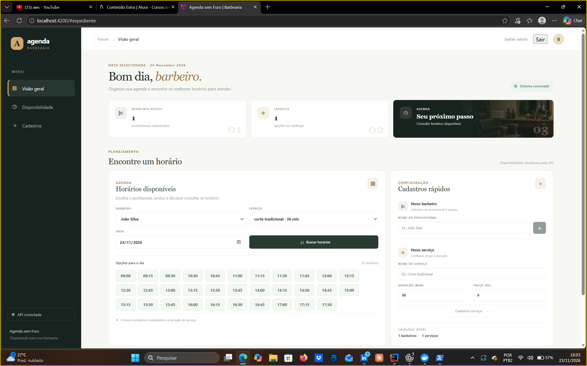

# Agenda sem Furo

Aplicação web para organizar a agenda de uma barbearia. O painel permite configurar profissionais, serviços e expediente, consultar horários livres e registrar ou cancelar reservas.



## Funcionalidades

- Autenticação administrativa com sessão, senha armazenada como hash BCrypt e proteção CSRF.
- Cadastro de barbeiros e serviços com duração e preço.
- Configuração de expediente semanal sem intervalos sobrepostos.
- Consulta de horários em intervalos de 15 minutos, respeitando expediente, duração do serviço e reservas existentes.
- Criação e cancelamento de reservas, com bloqueio de conflitos simultâneos para o mesmo profissional.
- Publicação de evento de confirmação no RabbitMQ após a gravação da reserva.
- Contratos REST documentados com OpenAPI/Swagger.

## Tecnologias

- **Back-end:** Java 21, Spring Boot, Spring Security, Spring Data JPA, Flyway e MySQL 8.4.
- **Front-end:** Angular 22, TypeScript e Vitest.
- **Mensageria e ambiente local:** RabbitMQ 4 e Docker Compose.

## Como executar localmente

Pré-requisitos: Java 21, Maven, Docker com Compose e Node.js 20.19+, 22.12+ ou 24+.

1. Na raiz do projeto, crie seu arquivo local de configuração e altere a senha de administrador de exemplo:

   ```powershell
   Copy-Item .env.example .env
   ```

2. Inicie MySQL e RabbitMQ e aguarde os dois containers ficarem saudáveis:

   ```powershell
   docker compose up -d mysql rabbitmq
   docker compose ps
   ```

3. Em um terminal, inicie a API:

   ```powershell
   mvn spring-boot:run
   ```

4. Em outro terminal, inicie o painel:

   ```powershell
   cd frontend
   npm install
   npm start
   ```

5. Acesse [http://localhost:4200](http://localhost:4200). Use o usuário e a senha definidos em `ADMIN_USERNAME` e `ADMIN_PASSWORD` no arquivo `.env`. Em uma base nova, cadastre um barbeiro e um serviço, configure o expediente e então consulte os horários.

O back-end carrega `.env` quando iniciado na raiz do repositório. A aplicação aplica a migração Flyway na inicialização. O Compose local publica MySQL e RabbitMQ somente no endereço local da máquina; os dados ficam em volumes persistentes.

## Organização do código

```text
src/main/java/br/com/agendasemfuro/
├── appointment/   # reservas, disponibilidade e ciclo de vida
├── barber/        # profissionais
├── catalog/       # serviços
├── notification/  # eventos de confirmação via RabbitMQ
├── schedule/      # expediente semanal
└── shared/        # segurança, erros, OpenAPI e fuso de negócio

frontend/src/app/  # painel Angular e comunicação com a API
src/main/resources/db/migration/ # esquema versionado pelo Flyway
```

As regras de negócio ficam nos serviços; os controllers tratam HTTP e DTOs; os repositórios encapsulam acesso ao banco. A criação de reservas bloqueia a linha do barbeiro durante a verificação de conflito, evitando duas reservas simultâneas para o mesmo profissional.

## API

Todas as rotas exigem sessão autenticada, exceto a inicialização de CSRF, o login e o health check.

| Método | Rota | Ação |
| --- | --- | --- |
| `GET` | `/api/barbers` | Listar barbeiros ativos |
| `POST` | `/api/barbers` | Cadastrar barbeiro |
| `GET` | `/api/services` | Listar serviços ativos |
| `POST` | `/api/services` | Cadastrar serviço |
| `GET` | `/api/barbers/{id}/working-hours` | Consultar expediente |
| `POST` | `/api/barbers/{id}/working-hours` | Cadastrar intervalo de expediente |
| `GET` | `/api/barbers/{id}/availability?date=AAAA-MM-DD&serviceId={id}` | Consultar horários disponíveis |
| `POST` | `/api/appointments` | Criar reserva |
| `GET` | `/api/appointments/{id}` | Consultar reserva |
| `PATCH` | `/api/appointments/{id}/cancel` | Cancelar reserva |

Com a API ativa, a documentação interativa fica em [http://localhost:8080/swagger-ui.html](http://localhost:8080/swagger-ui.html) e o estado do serviço em [http://localhost:8080/actuator/health](http://localhost:8080/actuator/health). O Swagger também exige login.

## Segurança e configuração

- `.env` e outros arquivos `.env.*` são ignorados pelo Git; `.env.example` contém apenas valores de desenvolvimento.
- Configure senhas próprias. `ADMIN_PASSWORD` precisa ter pelo menos 16 caracteres.
- A sessão expira após 30 minutos de inatividade. Cookies usam `HttpOnly` e `SameSite=Strict`; o token CSRF é exigido nas operações de escrita.
- `SESSION_COOKIE_SECURE=false` só é usado no ambiente local HTTP. Em um ambiente HTTPS, configure `SESSION_COOKIE_SECURE=true`.
- A aplicação usa o fuso de negócio `America/Sao_Paulo` para horários e registros de criação.

Este repositório é um projeto de estudo e demonstração. O painel é administrativo e protegido por login; não há fluxo público de autoagendamento. A confirmação enviada pelo RabbitMQ é simulada. A publicação ocorre após o commit, mas ainda não há outbox nem retentativas se o broker estiver indisponível. Use dados fictícios na demonstração.

## Verificações

Os testes automatizados podem ser executados com:

```bash
mvn test
cd frontend
npm test -- --watch=false
```

Para gerar o build otimizado do painel:

```bash
cd frontend
npm run build
```

O fluxo principal também foi conferido localmente com MySQL e RabbitMQ: cadastro de expediente, consulta de horários, reserva, conflito de horário, cancelamento e liberação do horário.

## Próximos passos possíveis

- Criar fluxo público de autoagendamento e consulta/cancelamento com token.
- Adicionar outbox e retentativas para eventos de confirmação.
- Automatizar builds e verificações em integração contínua.
- Fazer deploy como exercício adicional de cloud; isso não é necessário para usar o projeto como portfólio.

## Publicação no LinkedIn

Um rascunho pronto para personalizar está em [`docs/publicacao-linkedin.md`](docs/publicacao-linkedin.md).
